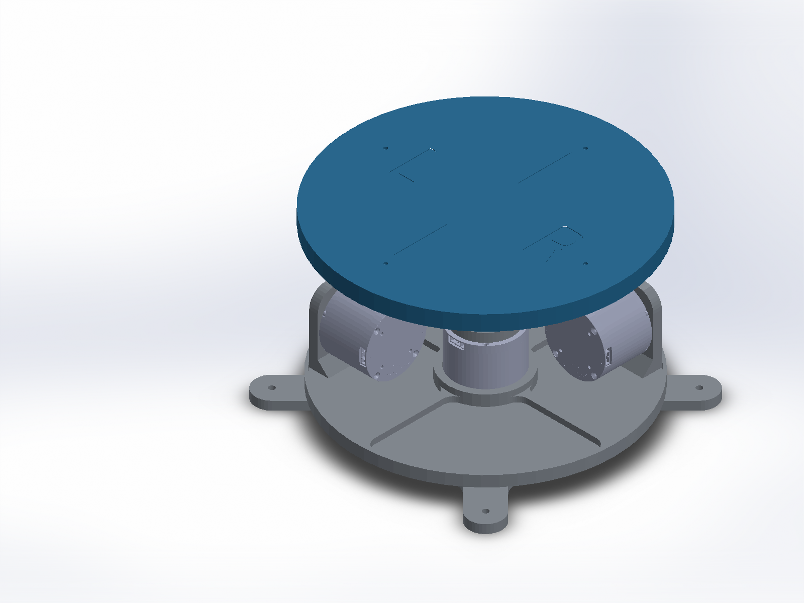

# ARGUS Footpedal

CAD, a working bill of materials, and software references for developing the ARGUS footpedal using the TriPilot-FF mechanism as a starting point. This repository keeps the existing ARGUS servo design separate from the reconstructed TriPilot reference so the two can be compared without confusing their parts or electronics.

**Status:** CAD reference and development baseline, not a validated build kit. The TriPilot assembly is fixed in one pose, its structural solids are faceted imports, and several purchasing specifications remain unconfirmed. No motor-control software has been tested on ARGUS hardware.



## Get the complete project

Install [Git LFS](https://git-lfs.com/) before cloning. CAD is stored with LFS; the authors' software is a pinned Git submodule.

```sh
git lfs install
git clone --recurse-submodules https://github.com/Kelvinchan324/ARGUS_footpedal.git
cd ARGUS_footpedal
git lfs pull
```

For an existing clone, run `git submodule update --init --recursive` and `git lfs pull`. A GitHub ZIP download does not populate the upstream submodule; use a Git clone for the complete project.

## Start here

| Item | Location |
| --- | --- |
| Original ARGUS SolidWorks assembly | [cad/argus-original/foot_pedal_assem.SLDASM](cad/argus-original/foot_pedal_assem.SLDASM) |
| Reconstructed TriPilot assembly | [cad/tripilot-reference/TriPilot_pedal_reconstructed.SLDASM](cad/tripilot-reference/TriPilot_pedal_reconstructed.SLDASM) |
| TriPilot component STLs | [cad/tripilot-reference/exchange_parts](cad/tripilot-reference/exchange_parts) |
| Working BOM with evidence and gaps | [bom/BOM.md](bom/BOM.md) |
| Control code and key entry points | [software/README.md](software/README.md) |
| CAD limitations and editing workflow | [docs/CAD_GUIDE.md](docs/CAD_GUIDE.md) |
| Proposed improvements | [docs/DEVELOPMENT.md](docs/DEVELOPMENT.md) |
| Source attribution and license status | [THIRD_PARTY_NOTICES.md](THIRD_PARTY_NOTICES.md) |

## Scope

The original folder includes its available SolidWorks parts, print exports, sole models, and boot reference geometry. The TriPilot folder includes the website GLB, 16 grouped STL exports, 16 native part documents, and the reconstructed assembly. Reproducible conversion and SolidWorks automation scripts live in `tools/reconstruction`.

Temporary SolidWorks locks, virtual environments, duplicate test imports, BMP previews, and regenerable intermediate mesh shells are intentionally excluded. The original source folder outside this repository is not modified.

## Hardware safety

Do not run the upstream launch files on powered hardware without reviewing them: they can enable motors and target a whole mobile robot. Establish mechanical stops, guarding, a hardware power cutoff, current and torque limits, a communication watchdog, and calibration before testing haptics. Start unloaded with restrained hardware and low limits. This repository does not certify safe loads or operation.

## Attribution

TriPilot-FF is the work of Zihao Li, Yanan Zhou, Ranpeng Qiu, Hangyu Wu, Guoqiang Ren, and Weiming Zhi. See the [project website](https://jeong-zju.github.io/RSS-TriPilot-FF-Page/), [paper](https://arxiv.org/abs/2602.09888), and [official software](https://github.com/Jeong-zju/zeno-wholebody-teleop). This is an independent ARGUS development repository, not an official release or endorsement by the authors. No blanket license is applied across assets with different or unresolved provenance; see the notices before redistribution.
